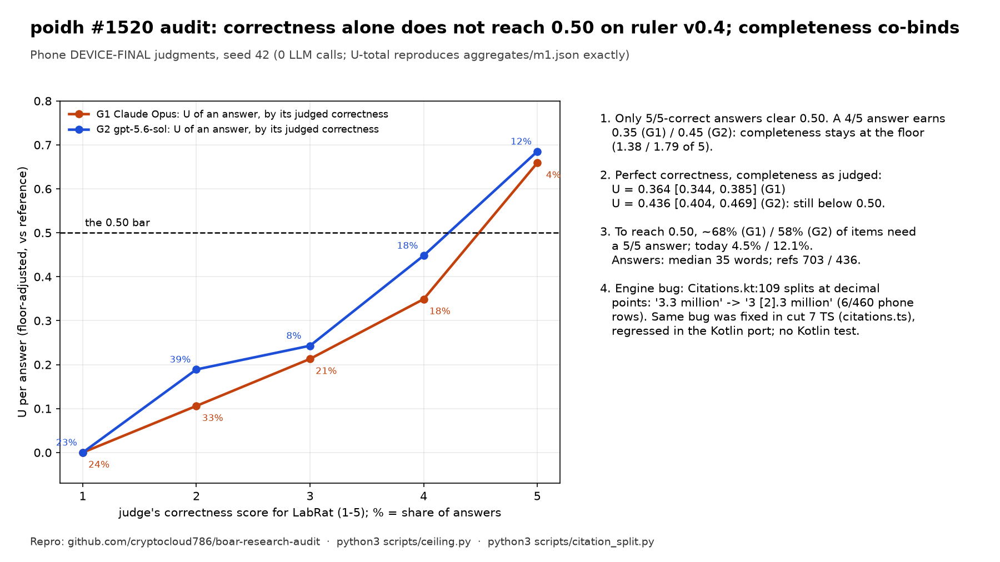

# boar-research-audit: two findings for poidh bounty #1520

Audit of r4to's offline-AI research record ([boar-research](https://github.com/r4topunk/boar-research), [boar-bench](https://github.com/r4topunk/boar-bench), [boar-traces](https://huggingface.co/datasets/r4topunk/boar-traces), [labrat-boar-fork](https://github.com/r4topunk/labrat-boar-fork)) for [poidh bounty #1520](https://poidh.xyz/base/bounty/1520). Everything here is computed from the published files with **0 LLM calls**, and every number can be re-run with the commands below.



**TL;DR**

1. **The ruler cannot be passed by fixing correctness or retrieval alone. Completeness is a second binding constraint.** In the published DEVICE-FINAL judgments, an answer the judge scores 4/5 on correctness still earns only **0.35 (Claude) / 0.45 (gpt-5.6-sol)** of the reference, because its completeness score stays near the floor (1.38 / 1.79 out of 5). Take every answer, set its correctness to the reference's, and keep completeness and usefulness as judged: U-total is still **0.364 [0.344, 0.385]** (Claude) and **0.436 [0.404, 0.469]** (gpt-5.6-sol). Both are below 0.50. Only 5/5-correct answers clear the bar. Reaching 0.50 would need such answers on about **68 % (Claude) / 58 % (gpt-5.6-sol) of items**. Today they are **4.5 % / 12.1 %** of answers. This bounds what any retrieval fix (claims #9251, #9227, #9232) can deliver at the shipped answer length (median 35 words; v0.4 references: median 703 / 436 words).
2. **An engine bug: LabRat's citation step cuts decimal numbers in two (`3.3 million` becomes `3 [2].3 million`). The bug was already fixed once and came back in the Kotlin port.** `Citations.kt:109` splits sentences at every `.`. The TypeScript engine fixed this exact bug in cut 7 (`citations.ts`, with a `citations.decimal.test.ts` regression test: *"9.4 million" got "9 [2].4 million"*). The Kotlin port went back to the pre-fix regex and has no test for `Citations.apply/attribute/check`. It shows in **6 of 460** published phone rows. Today it touches only the engine's final text (`AnswerEvent.Done.text`, recorded as `answer`), because the chat shows the streamed text instead. But that gap is itself the record's open bug F-2232, so **the planned fix for F-2232 would show this bug to users**.

Not claimed: neither finding changes the published 0/71 or the 0.165 / 0.242 numbers. I re-derived both numbers exactly (see below). Finding 2 has no effect on any judged score, because `blind()` removes the ` [n]` and joins the number back together before the judge sees it.

---

## Reproduce (about 1 minute, stdlib Python 3; matplotlib only for the card)

```bash
git clone https://github.com/cryptocloud786/boar-research-audit && cd boar-research-audit
bash scripts/fetch_inputs.sh          # downloads only the needed public files, pinned (see below)
python3 scripts/ceiling.py            # Finding 1 -> results/ceiling.json
python3 scripts/citation_split.py     # Finding 2 -> stdout (saved copy: results/citation_split.txt)
python3 scripts/card.py               # optional: redraws card.png
```

Pins: boar-research `0590f3cf2fb1c1d4abba72983fc1c95f3c3734b1` (v1.1.2), boar-bench `74a8984c09002a07e910837e1afc5e0dafb0dc68`, boar-traces HF revision `f96e277cf8584b38c35c01106c1fe77457dfaa81`, labrat-boar-fork `0ecd282d03a0c2e5a1130cd0016618b751506291`.

Sanity check built into `ceiling.py`: it re-implements U-total exactly as `rnd/research/coordinator/arms/device-final/tools/m1_agg.py` does (floor-adjusted `ma-1 / mr-1`, health weight 0.5, refused item u = 0, 71 headline items). It matches `aggregates/m1.json` to 1e-9 on all four phone runs: G1 s42 0.1668, G1 s43 0.1623, G2 s42 0.2440, G2 s43 0.2409. Running the original `m1_agg.py` on the same staged files also reproduces `m1.json` byte for byte.

---

## Finding 1: completeness is a co-binding constraint; correctness or retrieval alone cannot reach 0.50

### What the record concludes
The author's thesis (F-2236) and the delivery facts (F-1705: correct-any 0.65 when the item's own article is kept vs 0.28; F-1706: own article kept 54 %) present search and delivery as the place where the small model stops mattering. Several claims on this bounty build on that: #9251 says "the engine is not the bottleneck, retrieval is"; #9227 says "retrieval is the wall"; #9232 says "the binding constraint on the phone is RETRIEVAL on real phrasings". The answer style was frozen at Succinct (F-1699, F-1858, STYLE-SEFIX F-1656). Those style tests used Haiku-low judges or outcome labels on development sets, not the ruler.

### What the published ruler judgments show
U-total split by rubric dimension (same formula, one dimension at a time; phone, seed 42):

| | correctness | completeness | usefulness | U-total |
|---|---|---|---|---|
| G1 Claude Opus vs Claude refs | 0.382 | **0.052** | 0.080 | 0.167 |
| G2 gpt-5.6-sol vs Codex refs | 0.410 | **0.133** | 0.195 | 0.244 |

Each answer, by the correctness the judge gave it (both A/B orders, answered items only; phone, seed 42):

| judged correctness | G1 share | G1 U per answer | G1 completeness (1-5) | G2 share | G2 U per answer | G2 completeness |
|---|---|---|---|---|---|---|
| 1 | 23.5 % | 0.000 | 1.00 | 22.7 % | 0.000 | 1.00 |
| 2 | 32.6 % | 0.106 | 1.07 | 38.6 % | 0.189 | 1.45 |
| 3 | 21.2 % | 0.213 | 1.18 | 8.3 % | 0.243 | 1.18 |
| 4 | 18.2 % | **0.349** | **1.38** | 18.2 % | **0.448** | **1.79** |
| 5 | 4.5 % | 0.659 | 2.67 | 12.1 % | 0.685 | 2.50 |

Two bounds on what fixing correctness alone can buy, at today's answer length:

- **CF-A, perfect correctness with completeness and usefulness as judged.** LabRat's correctness is replaced by the reference's correctness in the same judge call, and refused items are answered. Result: **G1 0.364 [0.344, 0.385], G2 0.436 [0.404, 0.469]**. Both upper CI bounds are below 0.50. This is a lower bound for "only correctness improves", because in practice the judge also raises completeness on fully correct answers.
- **CF-B, every item answered like today's 5/5 answers.** Result: G1 0.659, G2 0.685. This is the optimistic end. It assumes every item reaches the completeness that today's best answers get, and those are mostly easy lookups. Mixing CF-B answers with today's answers, U-total reaches 0.50 only when **≈ 68 % (G1) / 58 % (G2) of items** are answered at the 5/5 profile. Today **4.5 % / 12.1 %** of answers are.

The same pattern holds on the second seed and on the desktop twin. In all 6 runs (4 phone, 2 desktop), CF-A falls between 0.362 and 0.443 and the required share between 58 % and 76 % (`results/ceiling.json`).

Why completeness is pinned: LabRat's answers have a median of **35 words** (phone, seed 42). The v0.4 references have a median of **703 words** (Claude) and **436 words** (Codex), and the judge sees author notes with **4.4 key points per item** on average. A 35-word answer cannot cover 4-5 points. The judge's completeness score therefore stays near the floor even when what the answer says is right.

### Why it matters
- **For the conclusions.** "Retrieval is the wall" is incomplete for the ruler. With perfect delivery and perfect reading, a Succinct-length answer still does not reach 0.50 under either judge family. Better retrieval (for example the 48 % to 61 % lift in #9251, or 100 % own-article delivery at F-1705's 65 % correct-any) cannot reach the ~68 % of items at 5/5 correctness *and* 5/5-level completeness that G1 needs.
- **For the record's method.** REFVAR (ruler/REFVAR-2026-10-21.md, rule 2) justified uncapped references because "uncapped does not lower U". That was measured on v0.1 dev items, with a Haiku-low judge, at about 485 words. The v0.4 Claude references actually used are 703 words, judged by Opus. LENGTHSHARE's "≈ 17 % of the gap is reference length" (F-1172) was measured against references of about 280 words. Neither result covers the final ruler. Note on prior work: F-183 and F-284 already observed that the 4B and deep tier pass 0.50 on correctness alone on V-para. What is new here: on the final ruler with the shipped 1.7B, correctness itself is only 0.38 / 0.41, and even perfect correctness leaves U at 0.36 / 0.44.
- **Actionable.**
  1. Report U per rubric dimension, plus the CF-A / CF-B bounds, next to every U-total. They come from the judgments already stored, at 0 cost.
  2. Test answer formats that raise key-point coverage without adding unsupported prose. For example: a structured answer that addresses each sub-question of the prompt in turn, with one sentence per sub-question taken from the delivered passage, instead of the Detailed persona that STYLE-SEFIX rejected (it added errors). Judge it on the ruler, not only with Haiku-low.
  3. For model-size work (#9234): the record shows that longer answers add errors, for the 1.7B (PARA135: confident errors 37 / 43 / 49 at 1 / 3 / 5 paragraphs; STYLE-SEFIX) and for the 4B and 35B (F-433, F-653). The constraint above is therefore an argument for a larger model *at a longer length*, not for a larger model at Succinct length.

### Caveats
- These are counterfactuals on the judges' own scores, not new judge runs. CF-A holds completeness fixed, which is pessimistic. CF-B assumes today's 5/5 answers are representative, which is optimistic. The truth lies between the two, and the 0.50 bar sits inside that band only if a large majority of items become fully correct.
- The 5/5 bucket is small: 6 answers (G1) and 16 (G2) on seed 42.
- One reference family per judge family, as in the published runs.
- Counter-evidence in the record: PARA135 found U flat across 1 / 3 / 5 paragraphs for the 1.7B, with confident errors rising (Haiku-low, CV5 dev). Simply writing more does not lift U. That is why the suggestion above targets key-point coverage judged on the ruler, not length.

---

## Finding 2: Citations.kt cuts decimals in two; a regression of a bug already fixed in cut 7

### The code
`android-native/engine/src/main/java/team/sopa/boar/engine/answer/Citations.kt` at `0ecd282d`:

- line 109: `private val SENTENCE = Regex("[^.!?\\n]+[.!?]*")`. `attribute()` (lines 115-138) walks these "sentences" and writes ` [n]` before the end punctuation (line 135).
- line 49: `private val SENTENCE_END = Regex("[.!?\\n]")`. `sentenceBefore()` (lines 53-60) uses it to find the sentence that a model-written `[n]` is checked against in CT-1 `check()` (lines 92-107).

So `around 3.3 million, with 51.8% Buddhist.` becomes three "sentences": `around 3.`, `3 million, with 51.` and `8% Buddhist.`. Attribution then writes `around 3 [2].3 million`. CT-1 also checks a model citation in `dating to 3.6 million years ago [2].` against only `6 million years ago`, a fragment without its subject.

### It was fixed before
`boar-research/rnd/research/coordinator/repro/cut7.vs-0cfd4a77.patch` (the TypeScript engine, cut 7) changes `src/routing/citations.ts` `attributeCitations` to `/(?:[^.!?\n]|(?<=\d)\.(?=\d))+[.!?]*/g`, with the comment *A "." between digits is a decimal point, not a sentence end: "9.4 million" got "9 [2].4 million" (Anvil, exp-35 traces)*, and adds `src/routing/citations.decimal.test.ts`. The Kotlin port has the pre-fix regex. No Kotlin test calls `Citations.apply`, `attribute` or `check`. The only caller is `AnswerPipeline.kt:215`. The engine even has a decimal-safe splitter already: `Compress.splitSentences` (`rag/Compress.kt:68`, "keeps abbreviations and decimals ... intact").

### In the published data
`scripts/citation_split.py` scans every published DEVICE-FINAL phone row (460 rows: M1 s42, s42b and s43, M2, M3, M4):

```
df-m1-v04-s42  cw-004  Mongolia's population is around 3 [2].3 million
df-m1-v04-s42  cw-006  Australia's total area is about 7 [1].7 million square kilometers
df-m1-v04-s43  cw-004  Mongolia's population is around 3 [2].3 million
df-m3-packproof-s42  st-boar-simplewiki-en-006  but 3 [1].30 inches fell in Cordoba
df-m3-packproof-s42  st-boar-simplewiki-en-018  dating to 3 [2].6 million years ago
df-m4-uxmatrix-s42   st-qa-money-se-016        the 1 [1].7% interest rate
6 of 460 rows; shownText (what the chat streams) has none of them
```

The field is `answer = AnswerEvent.Done.text` (`DeviceEvalRunner.kt:378`), which is `Citations.applyShown(...)` (`AnswerPipeline.kt:213-216`). `ChatViewModel.kt:691-693` ignores `Done.text` and keeps the streamed pieces.

### Impact (stated narrowly)
- **Judged scores: none.** The ruler judged `shownText`. Even where `answer` is used, `blind()` (`boar-bench/scorers/vendor/eval-lib/judge-core.mjs:13`) strips `\s*\[\d+\]` and so joins `3 [2].3` back into `3.3`.
- **Users today: none.** The chat shows the streamed text. That is open bug F-2232 ("the citation-support step (Citations.applyShown) is not applied to the streamed answer the chat shows ... Fixing it changes the engine").
- **Users after the F-2232 fix: about 1.3 % of answers** (6 / 460) would show a citation inside a number, and the 1.7B is exactly the model that writes decimals in populations, areas, doses and rates. The CT-1 fragment check would also keep or remove model citations based on half-sentences.
- **Fix:** port cut 7's regex to both `SENTENCE` and the `SENTENCE_END` walk in `sentenceBefore()` (treat `.` between digits as part of the sentence), and port `citations.decimal.test.ts`. `citation_split.py`, Part 3, shows the ported regex fixing the demo and both cut-7 test cases.

---

## What I checked and did not find
- U-total, CIs and the paired phone-vs-desktop deltas reproduce from the published traces (`m1_agg.py` → `m1.json` byte-identical).
- The A/B verdict mapping is correct on all 900 judgment rows (6 files). Position bias is small: LabRat's mean rubric score is 0.03-0.09 points higher when it is answer A.
- Health weights match `tags.health_safety` on all 75 items. The s42 / s42b merge has no duplicate or missing turns.
- Within items, the length ratio of the Claude reference to the Codex reference does not predict the G1-G2 gap (Spearman −0.01, n 66). Reference length does not explain the judge-family gap.
- Not duplicated from earlier claims: currency / NUM lexer (#9228, #9247), HealthGate (#9221, #9243), FTS upserts (#9236), pooled CR/CE (#9225), FACT-AVAIL pack coverage (#9227), retrieval (#9251), the 0.50 bar's construction (#9232), model size (#9234). Finding 1 builds on and qualifies #9251, #9227 and #9232.

## Files
- `scripts/fetch_inputs.sh`: pinned download of the inputs
- `scripts/common.py`: loaders and the U-total formula (same as `m1_agg.py`)
- `scripts/ceiling.py`: Finding 1, writes `results/ceiling.json`
- `scripts/citation_split.py`: Finding 2, regex port, data scan and fix demo (`results/citation_split.txt`)
- `scripts/card.py`: draws `card.png`

Author: Abdul AmberNeel (GitHub [cryptocloud786](https://github.com/cryptocloud786)). Analysis done with an AI research agent and checked against the published files. MIT licence for the scripts. The quoted record material keeps its own licences (boar-research: MIT / CC BY 4.0).
